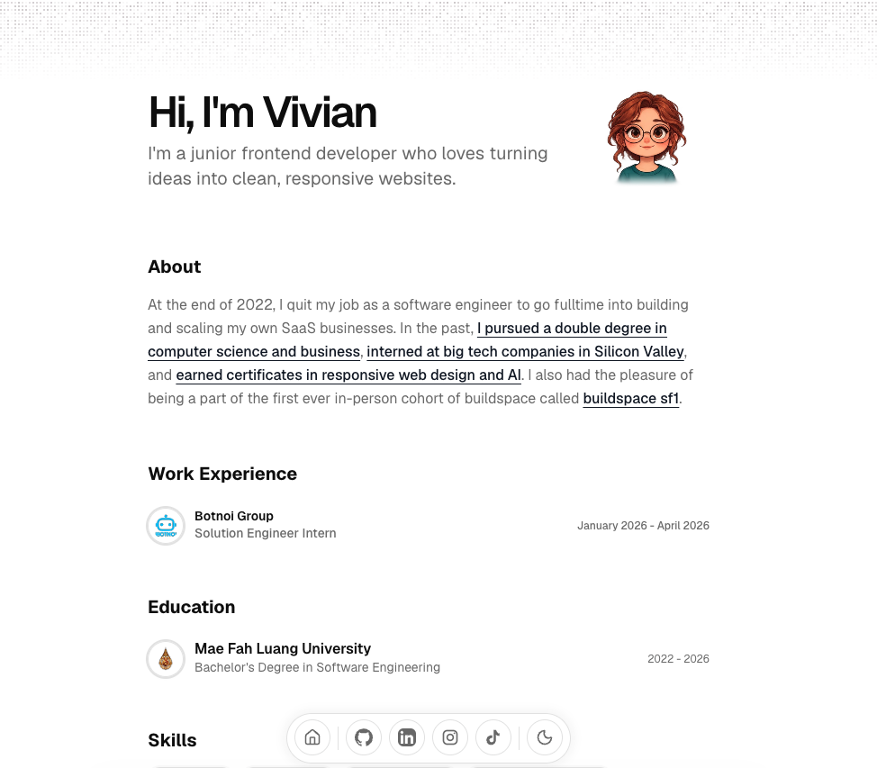

# Vivian's Minimalist Portfolio



## Table of Contents

- [Introduction](#introduction)
- [Features](#features)
- [Get Started](#get-started)
- [License](#license)

## Introduction

My personal portfolio as a junior frontend developer, built with Next.js, React, TypeScript, and Tailwind CSS. It brings together my skills, work experience, education, projects, and certificates in a simple, responsive design with shadcn/ui, Magic UI, and Motion animations.

## Features

- **Responsive Layout**: Designed for desktop, tablet, and mobile screens.
- **Interactive Mascot**: A character that follows the cursor and reacts when clicked.
- **Light and Dark Themes**: Switch themes from the navigation dock.
- **Smooth Animations**: Animated section entrances, dock magnification, and a scroll-to-top button.
- **Project Showcase**: Project cards with previews, technologies, and links to demos and source code.
- **Certificates**: Course descriptions and direct links to credentials from freeCodeCamp and Coursera.
- **Social Dock**: Quick access to my GitHub, LinkedIn, Instagram, and TikTok profiles.

## Get Started

1. **Clone the repository**

   ```sh
   git clone https://github.com/naked-vivi/portfolio_v1.git
   ```

2. **Go to the project folder**

   ```sh
   cd portfolio_v1
   ```

3. **Install dependencies**

   ```sh
   npm ci
   ```

4. **Run the development server**

   ```sh
   npm run dev
   ```

5. **Open [http://localhost:3000](http://localhost:3000)** in your browser.

Run the checks and create a production build with:

```sh
npm run lint
npx tsc --noEmit
npm run build
npm start
```

## License

This project is licensed under the [MIT License](./LICENSE).
